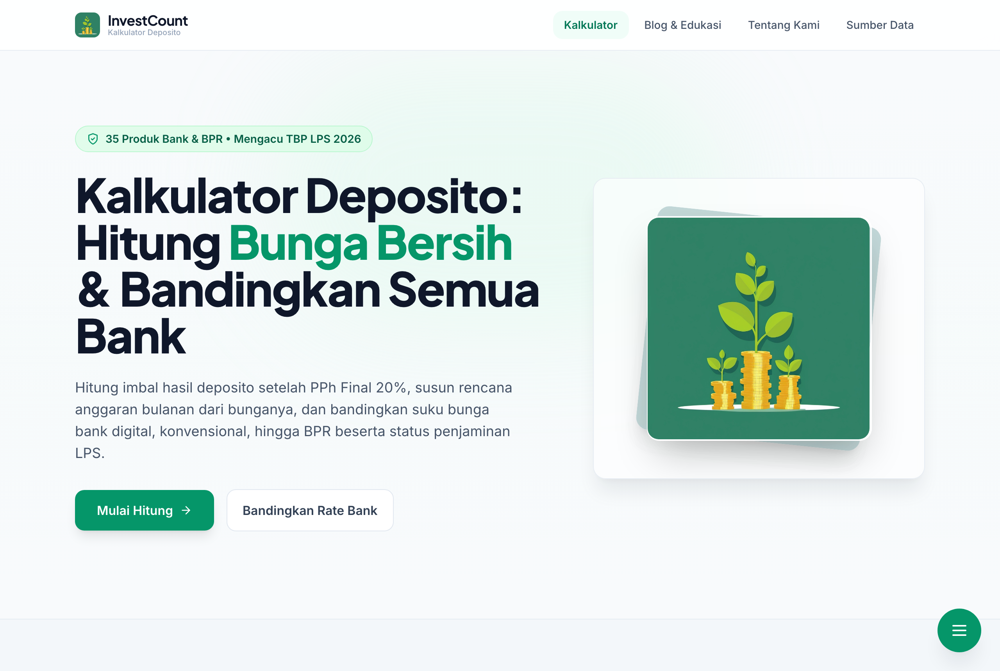

# InvestCount

<div align="center">



**Independent Indonesian deposit calculator, bank & BPR rate comparison, and monthly budget planner.**

*Hitung bunga deposito bersih dalam 5 detik. Gratis, tanpa login, dan tanpa iklan.*

[](https://github.com/HellBus1/InvestCount)
[](LICENSE)
[](https://investtcount.mattrmost.com/)

[Live App](https://investtcount.mattrmost.com/) • [Features](#features) • [Release Highlights](#release-highlights) • [Getting Started](#getting-started) • [Contributing](#contributing)

</div>

---

## Overview

Most Indonesian savers look at headline deposit interest rates without seeing what actually lands in their account after 20% final tax (PPh Final) or whether the rate stays within the LPS deposit insurance ceiling.

**InvestCount** solves this in one open-source, privacy-first web app:

- **Transparent math** — Displays exact 30/365 interest formulas, 20% PPh Final deductions, and official regulatory citations.
- **Audited bank & BPR data** — Covers **35 deposit products** (21 digital banks, 7 conventional banks, 7 BPRs) with direct links to each institution's official product page or RIPLAY.
- **Privacy-first** — Every calculation runs locally in the browser with no accounts, no paywalls, and no ads.

> *"Membantu setiap orang Indonesia memahami bagaimana uang mereka bekerja melalui deposito, dengan jujur dan sederhana."*

---

## Features

| Area | What It Does |
|---|---|
| **Deposit Calculator** | Real-time net return calculation for **Non-ARO**, **ARO**, and **ARO+** deposits after 20% PPh Final, plus an accessible native `<dialog>` simulator for 1–10 year ARO+ compounding. |
| **Bank & BPR Rate Comparison** | Searchable, filterable horizontal bar chart (Recharts) and expandable details table across 35 products (`Semua`, `Bank Digital`, `Bank Konvensional`, `BPR`), tenor & balance-tier filters, sorting, and live LPS guarantee indicators. |
| **LPS Guarantee Boundaries** | Visualizes official **TBP LPS** thresholds (`3,75%` Bank Umum & Digital IDR, `6,25%` BPR IDR, `2,00%` Valas; Rp2B balance cap) directly on the comparison chart and flags unguaranteed products. |
| **Monthly Budget Planner** | Maps net monthly deposit interest against routine household bills with 1-click scenario presets, quick-add expense chips, automatic 0% vs. 20% PPh threshold logic (≤ Rp7,5 jt vs. > Rp7,5 jt), searchable bank/BPR picker, 100% coverage capital estimator, and plain-text copy / `.txt` export. |
| **Education Blog (6 Guides)** | Concise MDX guides with WebP cover art covering deposit math, 2026 rates, BPR vs. conventional banks, ARO vs. Non-ARO, 20% PPh Final rules, and inflation impact. |
| **SSG Pre-rendering & SEO** | Zero-dependency Vite SSR + pre-rendering pipeline (`scripts/prerender.js`) generating 11 static HTML routes, structured JSON-LD (`WebSite`, `SoftwareApplication`, `FAQPage`, `BlogPosting`), `sitemap.xml`, `llms.txt`, and Cloudflare Pages `_redirects`. |

---

## Release Highlights

### v1.7.1 (Current)
- **Mobile & small-screen responsiveness** — Reclaimed horizontal mobile gutter in `.layout`, tuned the mobile Recharts chart with visible LPS reference lines and non-overlapping aligned labels, fixed badge/header wrapping in the rate details list, stabilized the Budget Planner dark summary card on narrow phones, and limited floating `QuickNav` to desktop (`md+`) so mobile controls never overlap.
- **Searchable bank & BPR lists** — Added real-time search inputs with clear actions and empty states to both **Rencana Anggaran Bulanan** and **Perbandingan Bunga Deposito Bank**.
- **ARO+ simulation modal modernization** — Rebuilt `NetWorthSimulationModal` on the v1.7 design system using a native `<dialog>` (`showModal()`, light-dismiss with Safari fallback, `overscroll-behavior: contain`), responsive grids, Indonesian copy, and `NaN%` guards.

### v1.7.0
- **Audited 35-product dataset & 2026 LPS rules** — Added digital, conventional, and BPR deposit rates with clickable RIPLAY links and live TBP LPS evaluation (`3,75%` / `6,25%` / `2,00%`, period `1 Oktober 2026 – 31 Januari 2027`).
- **Budget Planner onboarding** — Added 3-step quick guide, 1-click scenario presets, quick-add expense chips, live coverage progress card, and copy / `.txt` export.
- **Curated content & homepage refresh** — Streamlined the blog to 6 focused guides with WebP cover imagery and tightened homepage structure and copy.

### v1.6.0
- **Design system & SSG foundation** — Introduced centralized design tokens (`src/theme.ts`), `Plus Jakarta Sans` + `Inter` + `JetBrains Mono` typography, inline SVG icons (`src/components/Icon/Icon.tsx`), sticky navbar, automated Vite SSG pre-rendering, and `public/llms.txt`.

---

## Tech Stack

| Layer | Technologies |
|---|---|
| **Core** | React 18, TypeScript 5, Vite 6, React Router 6 |
| **Styling & Motion** | Tailwind CSS 3, typed tokens (`src/theme.ts`), DaisyUI 4, Motion |
| **Charts & Content** | Recharts 2.15, MDX 3 (`remark-gfm`, `rehype-slug`, `rehype-autolink-headings`, `gray-matter`, `reading-time`) |
| **Quality & Testing** | Jest 29 (`ts-jest`), ESLint 8, Prettier 3, Husky + lint-staged |

---

## Getting Started

### Prerequisites
- Node.js 18+ and npm

### Local Setup

```bash
git clone git@github.com:HellBus1/InvestCount.git
cd InvestCount
npm install
npm run dev
```

Open `http://localhost:5173` in your browser.

### Available Scripts

| Command | Purpose |
|---|---|
| `npm run dev` | Start the local Vite development server |
| `npm run build` | Run full production build: TypeScript check, client bundle, SSR bundle, and SSG pre-render (11 routes + `sitemap.xml`) |
| `npm run build:client` | Type-check (`tsc -b`) and build the client bundle into `dist/` |
| `npm run build:ssr` | Build the SSR server entry (`src/entry-server.tsx`) into `dist-ssr/` |
| `npm run build:prerender` | Pre-render static HTML routes into `dist/` and refresh `public/sitemap.xml` |
| `npm run preview` | Preview the production build locally |
| `npm test` | Run Jest unit tests (deposit calculations, LPS status rules, and budget planner services) |
| `npm run lint` | Run ESLint with `--max-warnings 0` |
| `npm run lint:fix` | Auto-fix lint issues across `src/` |
| `npm run format` | Format TypeScript, TSX, and CSS files with Prettier |

---

## Documentation

- **Design Tokens**: [`src/theme.ts`](src/theme.ts) — Typed color, typography, shadow, and radius contract shared with Tailwind CSS.
- **Directory Guidelines**: `SKILL.md` files in [`src/`](src/SKILL.md), [`src/components/`](src/components/SKILL.md), [`src/pages/HomePage/`](src/pages/HomePage/SKILL.md), and [`src/constants/`](src/constants/SKILL.md) — Concise UI and architecture standards used during development.

---

## Contributing

Contributions, rate corrections, and bug reports are welcome:

1. Fork the repository and create a branch from `master` (`git checkout -b fix/your-change`).
2. Make your changes while keeping code style consistent with `src/SKILL.md`.
3. Verify locally with `npm test`, `npm run lint`, and `npm run build`.
4. Open a Pull Request describing the change and how you verified it.

---

## License

Licensed under the Apache License 2.0. See [LICENSE](LICENSE) for details.

---

## Author

**Syubban Fakhriya**

- GitHub: [@HellBus1](https://github.com/HellBus1)
- LinkedIn: [syubban-fakhriya](https://www.linkedin.com/in/syubban-fakhriya/)

---

## Support

If InvestCount helps you plan your deposits, you can support ongoing maintenance and rate audits:

[](https://www.buymeacoffee.com/syubban)

---

## Acknowledgments

- **Starter Template**: [ts-react-tailwind-starter](https://github.com/HellBus1/ts-react-tailwind-starter)
- **Regulatory & Data References**: [LPS](https://www.lps.go.id), [OJK](https://www.ojk.go.id), [Bank Indonesia](https://www.bi.go.id), and official bank/BPR RIPLAY publications
- **Contributors & Users**: Everyone sharing rate updates and product feedback

---

<div align="center">

**Built for clearer financial decisions in Indonesia**

[Live App](https://investtcount.mattrmost.com/) • [Report Issue](https://github.com/HellBus1/InvestCount/issues) • [Request Feature](https://github.com/HellBus1/InvestCount/issues)

</div>
